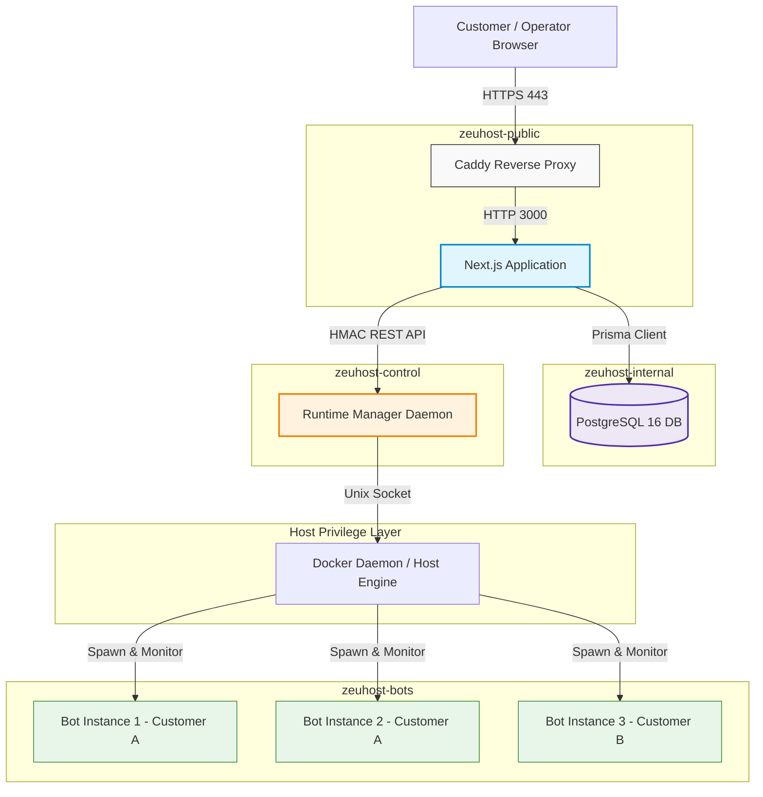
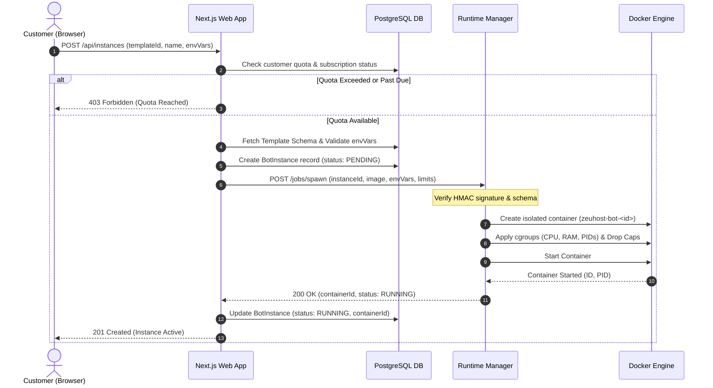
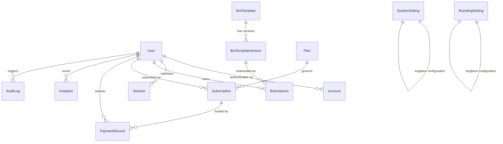
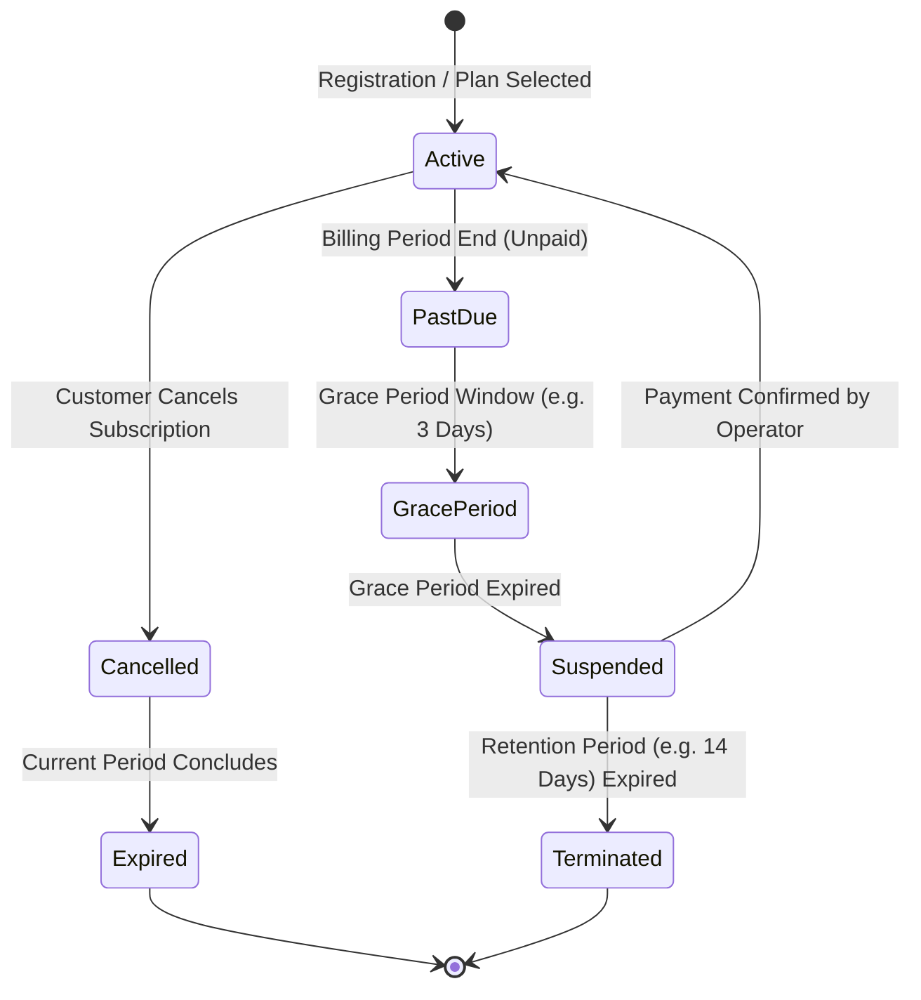

# ZeuHost Architecture & Implementation Plan

- **Project Name:** ZeuHost
- **Creator / Organization:** Zeuzz
- **Document Version:** 1.0.0
- **Status:** Approved Architecture Plan
- **Primary Deliverable:** `plan.md`

---

## 1. Executive Summary

ZeuHost is an open-source, self-hosted, white-label bot hosting platform created by Zeuzz. It is designed for single-operator deployment on standard Virtual Private Servers (VPS). The platform enables any independent operator to deploy the software on their own infrastructure, configure their own branding, pricing, and payment workflows, and offer multi-customer bot hosting services.

ZeuHost is strictly a hosting, orchestration, and management platform; it is not a bot development framework. The platform manages account lifecycles, containerized deployments, template registries, resource quotas, and billing records. Operators retain full sovereignty over their infrastructure, customer relationships, and business branding.

A comprehensive inspection of the repository was conducted before authoring this plan. The repository is currently empty (0 files, not initialized with Git). Therefore, this plan establishes the entire architecture, data model, security boundary, and implementation roadmap from the ground up.

---

## 2. Project Goals

1. **Turnkey VPS Deployment:** Enable an operator with standard Linux VPS hosting to deploy a fully functional instance using Docker Compose and local PostgreSQL in under fifteen minutes.
2. **True White-Label Customization:** Allow operators to rebrand the platform completely (product name, logos, color palette, landing page copy, legal links, and domain) without modifying core application code.
3. **Rigorous Multi-Tenant Isolation:** Ensure that multiple customers can host multiple bot instances on a single VPS without cross-customer data leakage, credential exposure, or file system access.
4. **Sandboxed Bot Execution:** Execute untrusted bot code within hardened, resource-constrained container environments with dropped privileges and no direct access to the host or Docker daemon.
5. **Decoupled Runtime Management:** Enforce a strict architectural boundary between the public-facing web dashboard and the privileged container orchestration service.
6. **Extensible Authentication:** Support email/password and social login (Google OAuth, optional GitHub OAuth) using per-installation operator credentials.
7. **Flexible Subscription & Quota Engine:** Provide customizable plans (Free, Tiered, Custom) with server-side quota enforcement and a modular billing system supporting manual payments and webhook integrations.
8. **Pluggable Template System:** Allow operators to publish reusable bot templates (Node.js, Python) with declarative configuration schemas and environment variable specifications.

---

## 3. Scope and Non-Goals

### In-Scope (MVP)

- **Web Application & Dashboards:** Next.js (App Router) web application providing a public landing page, customer dashboard, and operator administration interface.
- **Local Data Persistence:** PostgreSQL database running in an isolated Docker container on the host with Prisma ORM.
- **Authentication Engine:** Better Auth implementation with email/password, Google OAuth, session management, and role-based access control.
- **Privileged Runtime Daemon:** Dedicated, isolated background service (`runtime-manager`) communicating over an authenticated private channel to manage Docker containers.
- **Bot Sandboxing:** Containerized execution with CPU, memory, PID, and disk limits, dropped Linux capabilities, and isolated bridge networking.
- **Template Registry:** File- and database-backed template definitions for Node.js and Python runtimes with declarative configuration schemas.
- **Subscription & Manual Billing:** Tiered subscription management, quota enforcement, manual payment proof upload, and staff verification workflows.
- **Reverse Proxy & TLS:** Caddy reverse proxy integration with automated Let's Encrypt / ZeroSSL certificate management.
- **Operational Tooling:** Shell scripts for pre-flight environment validation, interactive setup, database backups, restoration, and zero-downtime upgrades.

### Out of Scope (Non-Goals for MVP)

- **Bot Application Development:** ZeuHost does not provide Discord, Telegram, or Slack bot application logic.
- **Multi-Operator SaaS:** Hosting multiple independent operators on a single ZeuHost installation is not supported in MVP. The architecture assumes one operator per VPS installation.
- **Clustered / Multi-Node Orchestration:** Kubernetes, Docker Swarm, and multi-server clustering are excluded from the initial release to keep operational overhead minimal.
- **Direct Docker Socket Exposure:** The public web application will never mount or interact directly with `/var/run/docker.sock`.
- **Direct Card Processing:** Raw credit card data will not be processed or stored on the VPS; billing relies on external hosted flows or manual operator confirmation.
- **External Cache/Queue Dependencies:** Redis is not required for MVP; background tasks and rate limiting will utilize database-backed mechanisms to keep the footprint low.

---

## 4. Confirmed Requirements and Assumptions

### Confirmed Requirements

- **Runtime Target:** Single VPS running modern 64-bit Linux (Ubuntu 22.04/24.04 LTS or Debian 12 recommended).
- **Core Stack:** TypeScript, Next.js (App Router), React, PostgreSQL 16, Prisma ORM, Docker Engine, Docker Compose v2, Caddy.
- **Authentication:** Better Auth with PostgreSQL adapter, supporting email/password and Google OAuth out of the box.
- **Role Hierarchy:** Operator (Owner), Staff (scoped permissions), and Customer (tenant-isolated access).
- **Registration Policies:** Operator-configurable modes: Open, Invitation-Only, and Closed.
- **Container Isolation:** Untrusted bot instances must run as non-root users with dropped capabilities and isolated networking.
- **White-Labeling:** Branding settings stored in PostgreSQL and rendered dynamically via CSS variables and server-side metadata.

### Assumptions

1. **Hardware Baseline:** The target VPS has at least 2 vCPU cores, 4 GB of RAM, and 40 GB of SSD storage.
2. **Network Connectivity:** The VPS is assigned at least one static public IPv4 or IPv6 address with ports 80 and 443 open.
3. **Bot Architecture:** Most hosted bots act as network clients (connecting outbound to Discord Gateway, Telegram Bot API, etc.) and do not require individual open inbound host ports.
4. **Email Delivery:** Operators who enable email verification must provide their own SMTP credentials; in development or offline mode, verification tokens can be output to the application log.
5. **Operator Responsibility:** The operator is responsible for securing the host operating system (SSH keys, firewall, package updates).

---

## 5. Unresolved Decisions

| # | Question | Recommended Default | Available Alternatives | Trade-Offs / Impact | MVP Blocker? |
|---|---|---|---|---|---|
| **D-1** | Authentication Library Selection | **Better Auth** | Auth.js (NextAuth v5), Lucia Auth | Better Auth offers native TypeScript schema generation, built-in two-factor support, and direct Prisma integration. Auth.js v5 has ongoing breaking changes. | No (Default chosen) |
| **D-2** | Reverse Proxy Selection | **Caddy 2.8+** | Traefik v3, Nginx | Caddy provides automated TLS, simple Caddyfile syntax, and lightweight memory footprint. Traefik is better for complex dynamic routing but has higher configuration complexity. | No (Default chosen) |
| **D-3** | Web App to Runtime Manager IPC | **Authenticated REST over Private Docker Network** | Unix Domain Socket, gRPC, Redis Queue | REST over a private Docker network with HMAC/bearer token authentication is simple to test, debug, and containerize. Unix sockets require host volume mounting. | No (Default chosen) |
| **D-4** | Background Task Processing | **PostgreSQL-backed polling (pg-boss or Prisma queue table)** | Redis + BullMQ | Avoiding Redis eliminates an entire infrastructure service, reducing VPS RAM consumption by ~100MB and simplifying maintenance. | No (Default chosen) |
| **D-5** | Inbound Webhooks for Bot Instances | **Deferred to Phase 5; Outbound-only for MVP** | Port-range mapping, Caddy sub-path proxying | Most bots use outbound websockets (Discord/Telegram long-polling). Supporting inbound webhooks requires dynamic reverse proxy reconfiguration. | No |
| **D-6** | White-Label OAuth on Custom Domains | **Primary Domain Callback with Cross-Domain Session Handshake** | Requiring operator to register every custom domain in Google Console | Google OAuth restricts dynamic redirect URIs. Routing auth through the primary domain simplifies OAuth registration for operators. | No |
| **D-7** | Default Billing Integration | **Manual Payment Proof & Approval Workflow** | Stripe Checkout, Lemon Squeezy | Manual billing works globally without merchant account verification, making ZeuHost accessible in any country. Stripe can be added as a plugin. | No (Default chosen) |
| **D-8** | Open Source License | **Apache License 2.0** | AGPLv3, MIT | Apache 2.0 protects the Zeuzz trademark, provides patent grants, and permits commercial white-label operator deployment while encouraging upstream contributions. | No (Requires owner signoff) |

---

## 6. Recommended Technology Stack

```
+-----------------------------------------------------------------------+
|                             Client Browser                            |
+-----------------------------------------------------------------------+
                                   | HTTPS (80/443)
+-----------------------------------------------------------------------+
|                         Caddy Reverse Proxy                           |
|       - Automated TLS (Let's Encrypt / ZeroSSL)                       |
|       - Header Sanitization & Rate Limiting                           |
+-----------------------------------------------------------------------+
                                   | HTTP (Internal Port 3000)
+-----------------------------------------------------------------------+
|                    Next.js 15 Web Application (App Router)            |
|  +---------------------------+  +----------------------------------+  |
|  | UI Layer (React 19, TS)   |  | API Layer (Route Handlers)       |  |
|  | - Landing Page & Branding |  | - Zod Validation Schemas         |  |
|  | - Customer Dashboard      |  | - Thin Controller Endpoints      |  |
|  | - Operator Dashboard      |  | - Better Auth Endpoints          |  |
|  +---------------------------+  +----------------------------------+  |
|                                  |                                    |
|  +---------------------------------------------------------------+    |
|  | Business Service Layer (Decoupled Services)                   |    |
|  | - AuthService        - BotService         - PlanService       |    |
|  | - BillingService     - TemplateService    - BrandingService   |    |
|  +---------------------------------------------------------------+    |
+-----------------------------------------------------------------------+
         | Database Connection (Port 5432)          | Internal RPC / HTTP
         v                                          v
+-----------------------------+   +------------------------------------+
|  PostgreSQL 16 (Local VPS)  |   | Runtime Manager Daemon (Isolated)  |
|  - Prisma 6 ORM             |   | - TypeScript / Node.js Engine      |
|  - Private Bridge Network   |   | - HMAC Authenticated API           |
|  - Encrypted Secrets        |   | - Docker Engine SDK                |
+-----------------------------+   +------------------------------------+
                                                    | Docker Socket (/var/run/docker.sock)
                                                    v
                                  +------------------------------------+
                                  | Docker Engine (Host Daemon)        |
                                  | - cgroups v2 resource limits       |
                                  | - Isolated bridge network          |
                                  +------------------------------------+
                                                    | Container Spawning
                                                    v
                                  +------------------------------------+
                                  | Customer Bot Containers            |
                                  | - Non-root execution (UID 1001)    |
                                  | - Dropped capabilities (ALL)       |
                                  | - Memory / CPU / Storage Caps      |
                                  +------------------------------------+
```

### Detailed Component Stack

- **Frontend & App Framework:** Next.js 15 with App Router, React 19, TypeScript 5.x.
- **Styling & Components:** Tailwind CSS with dynamic CSS variable theming, Lucide-React icons (strictly context-relevant).
- **Validation:** Zod 3.x for runtime schema validation on all API boundaries and environment configurations.
- **Database & ORM:** PostgreSQL 16 running in a Docker container with Prisma ORM 6.x.
- **Authentication:** Better Auth with PostgreSQL adapter, Argon2id password hashing, and PKCE-compliant OAuth.
- **Runtime Daemon:** Independent Node.js service running in an administrative container with restricted network exposure.
- **Reverse Proxy:** Caddy 2.8+ with automatic HTTPS and WebSocket proxying.
- **Process & Job Management:** In-database task scheduling via Prisma transactions and advisory locks.

---

## 7. System Architecture & Component Boundaries

### Architectural Tiers

1. **Edge & Ingress Tier:** Caddy terminates SSL, enforces HTTP security headers (HSTS, CSP, X-Frame-Options), applies connection rate-limiting, and routes requests to the Next.js container.
2. **Application Tier:** Next.js runs as an unprivileged service. It handles routing, server-rendered views, client interactivity, and API endpoints. Route handlers perform input validation via Zod and delegate immediately to the business service layer.
3. **Service & Domain Tier:** Pure TypeScript domain services encapsulating business rules, RBAC checks, quota limits, and database operations.
4. **Data Persistence Tier:** PostgreSQL stores all relational data. It is accessible only over the private Docker network `zeuhost-internal` and is never exposed to public ports.
5. **Privileged Orchestration Tier:** The `runtime-manager` service is the only component granted access to the Docker socket. It exposes a minimal, authenticated HTTP interface accessible only by the Next.js application tier on the `zeuhost-control` network.
6. **Execution Tier:** Bot instances run in ephemeral, hardened Docker containers attached to an egress-only network `zeuhost-bots`.

### Trust Boundaries

```
[ Public Internet ]
        |
=== TRUST BOUNDARY 1: Web Ingress (TLS, WAF, Rate Limiting) ===
        v
[ Caddy Reverse Proxy ]
        |
=== TRUST BOUNDARY 2: Application Boundary (Session Auth, CSRF) ===
        v
[ Next.js Web Application ] (Unprivileged Container)
        |
=== TRUST BOUNDARY 3: Privileged Control Boundary (HMAC Auth, Fixed API) ===
        v
[ Runtime Manager Daemon ] (Docker Socket Access)
        |
=== TRUST BOUNDARY 4: Host Isolation Boundary (cgroups, namespaces, seccomp) ===
        v
[ Customer Bot Containers ] (Untrusted Execution, UID 1001, CapDrop ALL)
```

- **Customer to Host:** Customers interact strictly with the Next.js web application. They never have shell access to the host or direct access to container orchestration.
- **Next.js to Docker:** Next.js cannot execute arbitrary Docker commands. It issues structured requests (`CreateInstanceRequest`, `StopInstanceRequest`) to the `runtime-manager` with validated parameters.
- **Bot to Host / Network:** Bot containers have no access to host file paths (root filesystem is read-only except for ephemeral `/tmp` and `/app/data`). They cannot reach the internal database or the web application networks.

---

## 8. Mermaid Architecture Diagrams

### High-Level System Architecture



### Instance Deployment & Lifecycle Sequence



---

## 9. Database Schema and ER Diagram

### Sensitive Data & Encryption Policy

- **Environment Secrets & API Tokens:** Customer bot tokens and private environment variables are encrypted at rest using AES-256-GCM before writing to PostgreSQL. The encryption key is derived from a master secret (`INSTANCE_SECRET_KEY`) stored exclusively in the host environment.
- **Passwords:** Passwords are never stored in plaintext. Better Auth hashes passwords using Argon2id with recommended memory and time cost parameters.
- **Log Sanitation:** Database queries and application loggers must scrub fields tagged as sensitive (`envVars`, `password`, `token`, `secret`).

### Prisma Schema Definition

```prisma
datasource db {
  provider = "postgresql"
  url      = env("DATABASE_URL")
}

generator client {
  provider = "prisma-client-js"
}

enum Role {
  OWNER
  STAFF
  CUSTOMER
}

enum UserStatus {
  ACTIVE
  SUSPENDED
  PENDING
}

enum RegistrationMode {
  OPEN
  INVITE_ONLY
  CLOSED
}

enum InstanceStatus {
  STOPPED
  RUNNING
  RESTARTING
  FAILED
  TERMINATED
}

enum SubscriptionStatus {
  ACTIVE
  PAST_DUE
  GRACE_PERIOD
  SUSPENDED
  EXPIRED
  CANCELLED
}

enum PaymentStatus {
  PENDING
  CONFIRMED
  FAILED
  REFUNDED
}

enum PaymentMethod {
  MANUAL_TRANSFER
  STRIPE
  CRYPTO
  EXTERNAL
}

enum RuntimeType {
  NODEJS
  PYTHON
}

// User & Authentication Models (Better Auth Compatible)
model User {
  id            String         @id @default(cuid())
  email         String         @unique
  emailVerified Boolean        @default(false)
  name          String?
  image         String?
  role          Role           @default(CUSTOMER)
  status        UserStatus     @default(ACTIVE)
  createdAt     DateTime       @default(now())
  updatedAt     DateTime       @updatedAt

  accounts      Account[]
  sessions      Session[]
  instances     BotInstance[]
  subscriptions Subscription[]
  payments      PaymentRecord[]
  invitations   Invitation[]   @relation("InvitedBy")
  auditLogs     AuditLog[]

  @@index([email])
  @@index([role, status])
}

model Account {
  id                String  @id @default(cuid())
  userId            String
  providerId        String
  accountId         String
  accessToken       String? @db.Text
  refreshToken      String? @db.Text
  accessTokenExpiresAt DateTime?
  refreshTokenExpiresAt DateTime?
  scope             String?
  password          String? @db.Text
  createdAt         DateTime @default(now())
  updatedAt         DateTime @updatedAt

  user              User    @relation(fields: [userId], references: [id], onDelete: Cascade)

  @@unique([providerId, accountId])
  @@index([userId])
}

model Session {
  id        String   @id @default(cuid())
  userId    String
  token     String   @unique
  expiresAt DateTime
  ipAddress String?
  userAgent String?
  createdAt DateTime @default(now())
  updatedAt DateTime @updatedAt

  user      User     @relation(fields: [userId], references: [id], onDelete: Cascade)

  @@index([userId])
  @@index([token])
}

model Verification {
  id         String   @id @default(cuid())
  identifier String
  value      String
  expiresAt  DateTime
  createdAt  DateTime @default(now())
  updatedAt  DateTime @updatedAt

  @@unique([identifier, value])
  @@index([identifier])
}

model Invitation {
  id         String    @id @default(cuid())
  email      String    @unique
  token      String    @unique
  role       Role      @default(CUSTOMER)
  inviterId  String
  expiresAt  DateTime
  acceptedAt DateTime?
  createdAt  DateTime  @default(now())

  inviter    User      @relation("InvitedBy", fields: [inviterId], references: [id], onDelete: Cascade)

  @@index([token])
}

// System & White-Label Configuration
model SystemSetting {
  id                String           @id @default("system_config")
  registrationMode  RegistrationMode @default(OPEN)
  allowGoogleAuth   Boolean          @default(true)
  allowGithubAuth   Boolean          @default(false)
  defaultPlanId     String?
  smtpHost          String?
  smtpPort          Int?
  smtpUser          String?
  smtpPassword      String?          @db.Text // Encrypted
  smtpFromEmail     String?
  smtpFromName      String?
  updatedAt         DateTime         @updatedAt
}

model BrandingSetting {
  id              String   @id @default("branding_config")
  productName     String   @default("ZeuHost")
  companyName     String   @default("Zeuzz")
  logoUrl         String?
  faviconUrl      String?
  primaryColor    String   @default("#0f172a")
  accentColor     String   @default("#2563eb")
  supportEmail    String?
  footerText      String?  @default("Powered by ZeuHost open-source bot platform.")
  documentationUrl String?
  termsUrl        String?
  privacyUrl      String?
  customDomain    String?  @unique
  landingHeadline String   @default("Host Your Bots with Zero Hassle")
  landingSubheadline String @default("Reliable, dedicated bot hosting powered by your independent operator.")
  updatedAt       DateTime @updatedAt
}

// Bot Templates & Runtime Registry
model BotTemplate {
  id          String               @id @default(cuid())
  slug        String               @unique
  name        String
  description String               @db.Text
  category    String               @default("general")
  runtime     RuntimeType
  iconUrl     String?
  isOfficial  Boolean              @default(true)
  isActive    Boolean              @default(true)
  createdAt   DateTime             @default(now())
  updatedAt   DateTime             @updatedAt

  versions    BotTemplateVersion[]

  @@index([slug, isActive])
}

model BotTemplateVersion {
  id                   String        @id @default(cuid())
  templateId           String
  versionTag           String        // e.g. "1.0.0"
  dockerImage          String        // e.g. "zeuhost/template-discord-js:1.0.0"
  requiredEnvSchema    Json          // Declarative field definitions
  defaultResourceLimits Json         // Memory, CPU, disk defaults
  startupCommand       String?
  isActive             Boolean       @default(true)
  createdAt            DateTime      @default(now())

  template             BotTemplate   @relation(fields: [templateId], references: [id], onDelete: Cascade)
  instances            BotInstance[]

  @@unique([templateId, versionTag])
  @@index([templateId])
}

// Bot Instances
model BotInstance {
  id                 String             @id @default(cuid())
  customerId         String
  templateVersionId  String
  name               String
  containerId        String?            @unique
  status             InstanceStatus     @default(STOPPED)
  encryptedEnvVars   String             @db.Text // AES-256-GCM encrypted payload
  cpuLimitCores      Float              @default(0.5)
  memoryLimitMb      Int                @default(256)
  storageLimitMb     Int                @default(512)
  lastStartedAt      DateTime?
  lastStoppedAt      DateTime?
  exitCode           Int?
  failureReason      String?            @db.Text
  createdAt          DateTime           @default(now())
  updatedAt          DateTime           @updatedAt

  customer           User               @relation(fields: [customerId], references: [id], onDelete: Cascade)
  templateVersion    BotTemplateVersion @relation(fields: [templateVersionId], references: [id], onDelete: Restrict)

  @@index([customerId])
  @@index([status])
}

// Plans & Billing
model Plan {
  id                   String         @id @default(cuid())
  slug                 String         @unique
  name                 String
  description          String         @db.Text
  priceMonthly         Int            @default(0) // In lowest currency unit (e.g. cents)
  currency             String         @default("USD")
  maxInstances         Int            @default(1)
  maxMemoryPerInstanceMb Int          @default(256)
  maxCpuPerInstance    Float          @default(0.5)
  maxStorageMb         Int            @default(512)
  isActive             Boolean        @default(true)
  createdAt            DateTime       @default(now())
  updatedAt            DateTime       @updatedAt

  subscriptions        Subscription[]

  @@index([slug, isActive])
}

model Subscription {
  id                String             @id @default(cuid())
  customerId        String
  planId            String
  status            SubscriptionStatus @default(ACTIVE)
  startedAt         DateTime           @default(now())
  currentPeriodEnd  DateTime
  gracePeriodEnd    DateTime?
  cancelAtPeriodEnd Boolean            @default(false)
  createdAt         DateTime           @default(now())
  updatedAt         DateTime           @updatedAt

  customer          User               @relation(fields: [customerId], references: [id], onDelete: Cascade)
  plan              Plan               @relation(fields: [planId], references: [id], onDelete: Restrict)
  payments          PaymentRecord[]

  @@index([customerId])
  @@index([status])
}

model PaymentRecord {
  id                 String        @id @default(cuid())
  subscriptionId     String?
  customerId         String
  amount             Int
  currency           String        @default("USD")
  method             PaymentMethod @default(MANUAL_TRANSFER)
  providerReference  String?
  status             PaymentStatus @default(PENDING)
  proofDocumentUrl   String?       @db.Text
  operatorNotes      String?       @db.Text
  confirmedByStaffId String?
  confirmedAt        DateTime?
  createdAt          DateTime      @default(now())
  updatedAt          DateTime      @updatedAt

  customer           User          @relation(fields: [customerId], references: [id], onDelete: Cascade)
  subscription       Subscription? @relation(fields: [subscriptionId], references: [id], onDelete: SetNull)

  @@index([customerId])
  @@index([status])
}

// Audit & Compliance
model AuditLog {
  id         String   @id @default(cuid())
  actorId    String?
  actorRole  Role?
  action     String   // e.g. "INSTANCE_CREATE", "PLAN_MODIFY", "USER_SUSPEND"
  entityType String   // e.g. "BotInstance", "Plan", "User"
  entityId   String?
  ipAddress  String?
  userAgent  String?
  metadata   Json?
  createdAt  DateTime @default(now())

  actor      User?    @relation(fields: [actorId], references: [id], onDelete: SetNull)

  @@index([actorId])
  @@index([action])
  @@index([createdAt])
}
```

### Entity Relationship Diagram



---

## 10. Authentication and OAuth Architecture

### Better Auth Integration Strategy

Better Auth runs inside the Next.js application tier. It handles session management using secure, HTTP-only, SameSite=Lax cookies, eliminating client-side token exposure.

### Required Flows

1. **Email / Password Flow:**
   - Password hashing: Argon2id (memory cost: 64MB, time iterations: 3, parallelism: 1).
   - Email verification: Signed, time-limited token stored in `Verification` table.
   - Password reset: Cryptographically secure random token emailed to the user, invalidating existing sessions upon reset.
2. **Social Login (Google & Optional GitHub):**
   - Each operator registers their own application in the Google Cloud Console / GitHub Developer Settings.
   - Credentials (`GOOGLE_CLIENT_ID`, `GOOGLE_CLIENT_SECRET`) are stored in server-side environment variables and never leaked to the browser.
   - Callback endpoints: `/api/auth/callback/google` and `/api/auth/callback/github`.
   - PKCE and state parameters verified to prevent authorization code interception and CSRF.
3. **Safe Account Linking Procedure:**
   - Accounts are **never** merged automatically based solely on matching unverified email addresses.
   - If an existing user logs in with Google whose email matches an existing email/password account, linking is only permitted if:
     1. The email on the OAuth provider is verified by the provider.
     2. The user is currently authenticated in an active session, or confirms their identity via their existing password prior to linking.

### Multi-Domain OAuth Architecture

When an operator attaches a custom domain (e.g. `bots.operator.com`):
- Google OAuth restricts dynamic redirect URIs.
- **Recommended Architecture:** The primary installation domain (configured in `.env`) acts as the canonical authentication provider. OAuth callbacks complete on the canonical domain, which then issues an encrypted, single-use authentication ticket redirecting the user back to the custom domain to set the session cookie.

---

## 11. Authorization and Tenant Isolation

### Role-Based Access Control (RBAC) Matrix

| Operation | Customer | Staff | Owner (Operator) |
|---|:---:|:---:|:---:|
| **Register / Login** | Allowed | Allowed | Allowed |
| **Manage Own Profile / Credentials** | Allowed | Allowed | Allowed |
| **Create / Start / Stop Own Bot Instances** | Allowed (Within Quota) | Allowed (Any Customer) | Allowed (Unrestricted) |
| **View Own Instance Logs & Metrics** | Allowed | Allowed | Allowed |
| **Upload Payment Receipts** | Allowed | Allowed | Allowed |
| **Verify / Confirm Customer Payments** | Denied | Allowed | Allowed |
| **Suspend / Unsuspend Customer Accounts** | Denied | Allowed | Allowed |
| **Create / Edit Bot Templates** | Denied | Denied | Allowed |
| **Modify Plans & Quotas** | Denied | Denied | Allowed |
| **Modify White-Label Branding Settings** | Denied | Denied | Allowed |
| **View System Audit Logs** | Denied | Read-Only | Full Access |
| **Modify System & SMTP Settings** | Denied | Denied | Allowed |

### Tenant Isolation Enforcement

Every query touching customer data must enforce tenant scoping at the service layer:

```typescript
// Example: Strict Tenant Scoping in BotService
export async function getCustomerInstance(customerId: string, instanceId: string) {
  const instance = await prisma.botInstance.findFirst({
    where: {
      id: instanceId,
      customerId: customerId, // Enforces absolute tenant boundary
    },
    include: { templateVersion: true },
  });

  if (!instance) {
    throw new NotFoundError("Instance not found or access denied.");
  }
  return instance;
}
```

- Staff and Owner roles bypass customer scoping only through explicit administrative routes (`/api/admin/...`) where access is logged to `AuditLog`.
- Insecure Direct Object References (IDOR) are prevented by requiring both `customerId` and `instanceId` on all mutating routes.

---

## 12. White-Label Configuration

### Customizable Assets & Properties

Operators configure branding through the Operator Dashboard. Settings are stored in the `BrandingSetting` table:

- **Identity:** Product Name, Company Name, Support Email, Documentation Link, Legal URLs (Terms, Privacy).
- **Logos & Media:** Header Logo (SVG/PNG), Favicon (`.ico` / `.png`), Landing Page Hero Illustration.
- **Color Theme:** Primary brand hex color, accent hex color, dark mode toggle.
- **Content:** Landing page headline, sub-headline, feature points, FAQ items.

### Technical Implementation

- **CSS Variable Injection:** The root layout (`apps/web/src/app/layout.tsx`) fetches branding settings during server-side rendering and injects dynamic CSS variables:
  ```html
  <style>
    :root {
      --brand-primary: #0f172a;
      --brand-accent: #2563eb;
    }
  </style>
  ```
- **Dynamic Metadata:** The layout utilizes Next.js `generateMetadata` to populate page titles, OpenGraph images, and favicons from the `BrandingSetting` database record.
- **Caching & Revalidation:** Branding settings are cached in memory. Updates in the dashboard call Next.js `revalidateTag('branding')` to refresh cached layouts instantly.
- **Separation of Secrets:** Public branding settings contain no secrets. Database credentials, SMTP passwords, and OAuth secrets remain strictly in `.env` and `SystemSetting` with AES-256-GCM encryption.

---

## 13. Bot Templates and Runtime Architecture

### Template Definition Specification

Templates decouple bot application logic from ZeuHost. Each template is packaged with a `zeuhost.template.json` specification:

```json
{
  "$schema": "https://zeuhost.org/schemas/template-v1.json",
  "name": "Discord.js Bot Starter",
  "slug": "discord-js-starter",
  "version": "1.0.0",
  "runtime": "NODEJS",
  "dockerImage": "zeuhost/runner-nodejs:20-alpine",
  "defaultResources": {
    "memoryMb": 256,
    "cpuCores": 0.5,
    "storageMb": 512
  },
  "envSchema": [
    {
      "key": "DISCORD_TOKEN",
      "label": "Discord Bot Token",
      "description": "Your bot token from the Discord Developer Portal",
      "type": "string",
      "required": true,
      "secret": true,
      "validationRegex": "^[A-Za-z0-9._-]{50,100}$"
    },
    {
      "key": "COMMAND_PREFIX",
      "label": "Command Prefix",
      "description": "Prefix for text commands (e.g. ! or ?)",
      "type": "string",
      "required": false,
      "default": "!"
    }
  ],
  "healthCheck": {
    "type": "process",
    "timeoutSeconds": 30
  }
}
```

### Privileged Runtime Manager Architecture

The `runtime-manager` is an independent Node.js daemon running inside the administrative container.

```
+-------------------------------------------------------------+
|                 Next.js Web Application                     |
+-------------------------------------------------------------+
                               |
                               | Authenticated REST (HMAC SHA-256)
                               v
+-------------------------------------------------------------+
|                 Runtime Manager Daemon                      |
|  - Validates HMAC signature and timestamp (replay protection)|
|  - Sanitizes container parameters against strict schemas    |
|  - Communicates directly with Docker via /var/run/docker.sock|
+-------------------------------------------------------------+
                               |
                               | Docker Engine API
                               v
+-------------------------------------------------------------+
|                     Docker Daemon                           |
+-------------------------------------------------------------+
```

### Container Hardening Specifications

When spawning a customer bot container:

1. **Non-Root Execution:** Containers run as UID/GID `1001:1001` (`zeubot:zeubot`).
2. **Capability Dropping:** All Linux capabilities are dropped: `--cap-drop ALL`.
3. **No New Privileges:** `security_opt: ["no-new-privileges:true"]`.
4. **Resource Quotas (cgroups v2):**
   - Memory hard limit: `--memory=<limit>m`
   - Memory swap limit: `--memory-swap=<limit>m` (disabled or identical to memory)
   - CPU throttling: `--cpus=<limit>`
   - Process limit: `--pids-limit=100` (prevents fork bombs)
5. **Filesystem Isolation:**
   - Root filesystem is mounted read-only: `--read-only`.
   - Ephemeral writable storage mounted via tmpfs: `/tmp` (max 64MB) and `/app/data` (isolated named Docker volume with storage quota).
6. **Network Isolation:** Attached to bridge network `zeuhost-bots`. DNS restricted to public resolvers (Cloudflare 1.1.1.1 / Google 8.8.8.8). Direct communication with the host network or internal database network is blocked via iptables rules.

---

## 14. Security Threat Model (STRIDE)

| Threat Category | Potential Attack Scenario | Mitigation in ZeuHost Architecture |
|---|---|---|
| **Spoofing** | Attacker registers with a forged email to claim operator privileges. | Role assignment is strictly locked in database schema; initial owner created via CLI bootstrap or one-time token; registration defaults to CUSTOMER role. |
| **Spoofing** | Attacker spoofs OAuth state to hijack account. | State and PKCE verification enforced by Better Auth; state tied to cryptographically secure session cookie. |
| **Tampering** | Customer modifies client request to assign a higher plan or alter CPU limits. | All quota limits and plan permissions are retrieved server-side from PostgreSQL; client-provided limits are discarded. |
| **Tampering** | Bot instance attempts to modify host filesystem or container binaries. | Root filesystem mounted read-only; capabilities dropped (`--cap-drop ALL`); container runs as unprivileged UID 1001. |
| **Repudiation** | Operator or customer denies initiating a container deletion or payment approval. | Immutable `AuditLog` records actor ID, role, action, target entity, timestamp, IP address, and user agent for all sensitive operations. |
| **Information Disclosure** | Customer A accesses environment variables or logs of Customer B via API. | Every API route validates ownership via tenant-scoped database queries (`where: { id, customerId }`); logs fetched only after ownership verification. |
| **Information Disclosure** | Host secrets exposed if PostgreSQL database is compromised. | Bot tokens and sensitive credentials encrypted with AES-256-GCM using `INSTANCE_SECRET_KEY` stored outside the database. |
| **Denial of Service** | Malicious bot runs an infinite loop or fork bomb to crash the VPS. | Hard cgroups limits enforced on every container: `--pids-limit 100`, `--cpus`, `--memory`. Container is killed if memory exceeds cap. |
| **Denial of Service** | Bot attempts SSRF by querying cloud metadata (`169.254.169.254`) or host ports. | Docker bridge network firewall rules explicitly drop outbound packets destined for link-local and private RFC 1918 addresses. |
| **Elevation of Privilege** | Attacker attempts container escape to gain root on host VPS. | Web app has zero access to Docker socket; Runtime Manager runs with restricted API; containers run non-root without privileges. |

---

## 15. Subscription Plans, Quotas, and Billing

### Plan Model & Quota Structure

Operators define plans in PostgreSQL via the Operator Dashboard:

| Field | Free Tier (Default) | Basic Tier | Pro Tier | Custom Enterprise |
|---|---|---|---|---|
| **Max Instances** | 1 | 3 | 10 | Configurable |
| **Memory / Instance** | 256 MB | 512 MB | 1024 MB | Configurable |
| **CPU / Instance** | 0.25 Cores | 0.5 Cores | 1.0 Cores | Configurable |
| **Storage / Instance**| 256 MB | 512 MB | 2048 MB | Configurable |
| **Price / Month** | $0.00 | Operator Config | Operator Config | Operator Config |

### Subscription Lifecycle State Machine



### Lifecycle Actions

1. **Active:** Normal operation; customer can create, start, and edit instances up to plan limits.
2. **Past Due / Grace Period:** Warning banner displayed in customer dashboard; existing instances continue running; creating new instances is blocked.
3. **Suspended:** Runtime Manager automatically issues `stop` commands to all running instances owned by the customer; instances cannot be started until payment is confirmed.
4. **Terminated:** If account remains suspended beyond the retention window (default: 14 days), bot volumes are deleted, and instances are marked `TERMINATED`.

### Manual Billing Workflow (MVP Baseline)

1. Operator configures payment instructions in dashboard (bank account, PayPal email, crypto address, or manual payment gateway link).
2. Customer selects a plan upgrade and submits a payment record with reference code and optional receipt screenshot.
3. Record is saved with `PaymentStatus = PENDING`.
4. Operator or Staff reviews payment in the admin portal and clicks "Confirm Payment".
5. Status updates to `CONFIRMED`, `Subscription` updates to `ACTIVE`, and period extends by 30 days.

---

## 16. VPS Deployment and Networking

### Single-VPS Deployment Layout

All services are orchestrated via a single root `docker-compose.yml`:

```
+-------------------------------------------------------------------------+
|                                Host VPS                                 |
|                                                                         |
|  +--------------------+                                                 |
|  | Caddy (Ports 80/443)|                                                |
|  +--------------------+                                                 |
|           |                                                             |
|           v (zeuhost-public)                                            |
|  +--------------------+       (zeuhost-control)   +------------------+  |
|  | Next.js Web App    | ------------------------> | Runtime Manager  |  |
|  +--------------------+                           +------------------+  |
|           |                                                |            |
|           v (zeuhost-internal)                             v            |
|  +--------------------+                          +-------------------+  |
|  | PostgreSQL 16 DB   |                          | Docker Engine     |  |
|  +--------------------+                          +-------------------+  |
|                                                            |            |
|                                                            v            |
|                                                  +-------------------+  |
|                                                  | Bot Containers    |  |
|                                                  | (zeuhost-bots)    |  |
|                                                  +-------------------+  |
+-------------------------------------------------------------------------+
```

### Network Topology & Port Bindings

- **Host Ports Exposed:**
  - `80/tcp` (Caddy HTTP -> automatic redirect to HTTPS)
  - `443/tcp` (Caddy HTTPS)
  - `22/tcp` (Host SSH, managed by operator)
  - **All other ports (3000, 5432, Docker socket) are strictly bound to internal Docker bridge networks or localhost.**
- **Docker Networks:**
  1. `zeuhost-public`: Caddy and Next.js.
  2. `zeuhost-internal`: Next.js and PostgreSQL.
  3. `zeuhost-control`: Next.js and Runtime Manager.
  4. `zeuhost-bots`: Runtime Manager and customer bot instances.

### Networking Scenarios & CGNAT Handling

1. **Standard VPS (Static Public IPv4 / IPv6):**
   - Operator points `A` / `AAAA` DNS records to VPS IP.
   - Caddy automatically requests and renews Let's Encrypt certificates.
2. **Dynamic Public IP:**
   - Operator uses dynamic DNS provider (e.g. Cloudflare DDNS). Caddy handles TLS transparently.
3. **Private IP / CGNAT (Home Lab / Local Server):**
   - Direct inbound 80/443 traffic is unreachable.
   - **Supported Solution:** Cloudflare Tunnel (`cloudflared`) or Tailscale Funnel. Caddy binds to the tunnel interface, allowing secure inbound routing without public IP addresses or port forwarding.

---

## 17. Installation and Upgrade Strategy

### Pre-Flight System Requirements

Before running the installer, the host must satisfy:
- OS: Linux x86_64 or ARM64 (Ubuntu 22.04+, Debian 12+).
- Docker Engine: version 24.0 or higher.
- Docker Compose: v2.20 or higher.
- Free Disk Space: Minimum 10 GB unallocated.
- Available RAM: Minimum 2 GB free memory.

### Step-by-Step Installation Process

```bash
# 1. Clone repository
git clone https://github.com/Zeuzz/zeuhost.git /opt/zeuhost
cd /opt/zeuhost

# 2. Run interactive preflight and setup script
chmod +x scripts/*.sh
./scripts/setup.sh

# 3. The setup script:
#    - Validates Docker and host capabilities
#    - Generates strong random secrets (DATABASE_PASSWORD, INSTANCE_SECRET_KEY, HMAC_SECRET)
#    - Prompts for Operator Domain, Product Name, and Owner Email
#    - Generates production docker-compose.yml and .env files
#    - Boots database and runs Prisma migrations: prisma migrate deploy
#    - Starts Caddy and application containers

# 4. Bootstrap initial Owner Account
./scripts/create-owner.sh --email admin@operator.com
```

### Zero-Downtime Upgrade Procedure

```bash
# 1. Pull latest release tags
cd /opt/zeuhost
git pull origin main

# 2. Trigger automated backup before migration
./scripts/backup.sh

# 3. Pull new images and apply database migrations
docker compose run --rm web npx prisma migrate deploy

# 4. Restart containers with rolling updates
docker compose up -d --build --remove-orphans

# 5. Verify service health
./scripts/healthcheck.sh
```

### Backup and Disaster Recovery

- **Automated Nightly Backups:** `scripts/backup.sh` executes `pg_dump` on PostgreSQL, compresses the dump with gzip, encrypts it with OpenSSL using a host backup key, and stores it in `/opt/zeuhost/backups`.
- **Restoration Test:** `scripts/restore.sh <backup_file.tar.gz>` stops the application, drops the current schema, recreates the database, loads the dump, and restarts services.

---

## 18. Proposed Repository Structure

A clean, modular structure is selected. A heavy monorepo tool (Nx/Turborepo) is intentionally avoided for MVP to eliminate build tool overhead, while maintaining distinct package boundaries for future extraction:

```
zeuhost/
├── .github/                      # CI/CD workflows and issue templates
├── apps/
│   └── web/                      # Next.js 15 Web Application
│       ├── public/               # Default static assets (logos, favicons)
│       ├── src/
│       │   ├── app/              # App Router pages and layouts
│       │   │   ├── (auth)/       # Login, Register, Forgot Password
│       │   │   ├── (customer)/   # Customer Dashboard & Bot Management
│       │   │   ├── (operator)/   # Admin Portal, Settings, Billing, Users
│       │   │   ├── api/          # Route Handlers (Auth, Instances, Admin)
│       │   │   ├── layout.tsx    # Root layout with dynamic branding styles
│       │   │   └── page.tsx      # Public landing page
│       │   ├── components/       # Reusable UI components
│       │   ├── lib/              # Utility functions, Better Auth client/server
│       │   └── services/         # Decoupled business logic service layer
│       │       ├── auth.service.ts
│       │       ├── bot.service.ts
│       │       ├── branding.service.ts
│       │       ├── plan.service.ts
│       │       └── runtime-client.ts # Communicates with Runtime Manager
│       ├── Dockerfile            # Multi-stage production build for Next.js
│       ├── package.json
│       └── tsconfig.json
├── packages/
│   ├── db/                       # Database Schema & Client
│   │   ├── prisma/
│   │   │   ├── schema.prisma     # Canonical database schema
│   │   │   └── migrations/       # Versioned Prisma migrations
│   │   ├── src/                  # Exported Prisma client instance
│   │   ├── package.json
│   │   └── tsconfig.json
│   ├── runtime-manager/          # Privileged Container Orchestration Daemon
│   │   ├── src/
│   │   │   ├── docker/           # Dockerode / Docker Engine API client
│   │   │   ├── routes/           # REST endpoints for container actions
│   │   │   ├── security/         # HMAC verification, parameter sanitization
│   │   │   └── index.ts          # Server entrypoint
│   │   ├── Dockerfile            # Container definition for daemon
│   │   ├── package.json
│   │   └── tsconfig.json
│   └── shared/                   # Shared TypeScript Types & Validation Schemas
│       ├── src/
│       │   ├── schemas/          # Zod validation schemas
│       │   └── types/            # DTOs, Enums, System interfaces
│       ├── package.json
│       └── tsconfig.json
├── templates/                    # Starter Bot Templates
│   ├── nodejs-discord/           # Official Node.js Discord starter
│   │   ├── Dockerfile
│   │   ├── package.json
│   │   ├── index.js
│   │   └── zeuhost.template.json
│   └── python-telegram/          # Official Python Telegram starter
│       ├── Dockerfile
│       ├── requirements.txt
│       ├── main.py
│       └── zeuhost.template.json
├── deploy/                       # Deployment Assets
│   ├── Caddyfile                 # Caddy reverse proxy configuration
│   ├── docker-compose.yml        # Production multi-container composition
│   ├── docker-compose.dev.yml    # Local development composition
│   └── .env.example              # Documented environment template
├── docs/                         # Operator and Developer Guides
│   ├── architecture.md
│   ├── installation.md
│   ├── oauth-setup.md
│   ├── template-development.md
│   └── security.md
├── scripts/                      # Operational Scripts
│   ├── setup.sh                  # Interactive initial setup script
│   ├── preflight.sh              # Host requirements validator
│   ├── create-owner.sh           # CLI owner account bootstrapper
│   ├── backup.sh                 # PostgreSQL automated backup script
│   ├── restore.sh                # Backup restoration script
│   └── healthcheck.sh            # End-to-end container & DB health probe
├── plan.md                       # This architecture document
├── README.md                     # Project overview and quickstart
└── LICENSE                       # Open source license (Apache 2.0 recommended)
```

---

## 19. Implementation Roadmap

### Phase 0: Repository Inspection & Foundation Architecture

- **Objectives:** Establish baseline repository structure, configure package manager, set up shared build configurations, and define environment schemas.
- **Dependencies:** None.
- **Deliverables:** Working repository skeleton, root `package.json`, TypeScript configs, and `.env.example`.
- **Tasks:**
  - [ ] Initialize Git repository with main branch.
  - [ ] Configure pnpm workspace or npm workspaces for modular packages.
  - [ ] Author root `.gitignore`, `.editorconfig`, and root `README.md`.
  - [ ] Create `packages/shared` with Zod validation schemas for system settings and bot configurations.
  - [ ] Define comprehensive `.env.example` documenting all configuration keys.
- **Acceptance Criteria:** Repository compiles cleanly across all packages using TypeScript without errors.
- **Required Tests:** TypeScript build validation check.
- **Risks & Mitigations:** Over-complicating monorepo tooling; mitigated by using native workspace features without heavy third-party build orchestrators.

### Phase 1: Database Layer & Core Models

- **Objectives:** Implement PostgreSQL Docker setup, build canonical Prisma schema, generate migrations, and create database client utilities.
- **Dependencies:** Phase 0 completion.
- **Deliverables:** `packages/db` with complete Prisma schema, initial migration, and seed scripts.
- **Tasks:**
  - [ ] Create `packages/db/prisma/schema.prisma` matching the approved specification.
  - [ ] Set up local Docker Compose service for PostgreSQL 16.
  - [ ] Generate initial Prisma migration: `prisma migrate dev --name init`.
  - [ ] Author database seed script (`prisma/seed.ts`) populating default plans and template definitions.
  - [ ] Implement database client singleton with connection pooling and logging controls.
- **Acceptance Criteria:** `prisma migrate deploy` succeeds against a fresh PostgreSQL instance, and seed script executes idempotently.
- **Required Tests:** Integration tests verifying database schema constraints, foreign key cascades, and unique indexes.
- **Risks & Mitigations:** Database connection pool exhaustion during high traffic; mitigated by setting explicit pool limits in Prisma connection URLs.

### Phase 2: Authentication, Authorization & Owner Bootstrap

- **Objectives:** Implement Better Auth integration, email/password flows, Google OAuth, session verification, and secure operator creation.
- **Dependencies:** Phase 1 completion.
- **Deliverables:** Complete auth API endpoints, session middleware, login/registration UI, and `create-owner.sh` script.
- **Tasks:**
  - [ ] Integrate Better Auth with Prisma adapter in `apps/web`.
  - [ ] Implement email and password authentication with Argon2id hashing.
  - [ ] Implement Google OAuth provider integration with PKCE.
  - [ ] Build registration policy handler (Open, Invite-Only, Closed).
  - [ ] Create server-side session validation utilities and role-based route guards.
  - [ ] Implement `scripts/create-owner.sh` to allow secure CLI creation of the initial Owner account.
  - [ ] Build customer login, registration, and password reset user interfaces.
- **Acceptance Criteria:** Users can register, log in, link OAuth accounts, and receive session cookies. Unauthenticated requests to protected routes return 401/403.
- **Required Tests:** Unit tests for password hashing; integration tests for session creation and role verification; security tests for unauthorized role elevation.
- **Risks & Mitigations:** OAuth redirect tampering; mitigated by enforcing exact redirect URI matching and validating state nonces.

### Phase 3: White-Label Branding & Public Web Experience

- **Objectives:** Build public landing page, operator branding settings portal, and dynamic theme injection.
- **Dependencies:** Phase 2 completion.
- **Deliverables:** Public landing page, operator branding dashboard, and dynamic CSS injection engine.
- **Tasks:**
  - [ ] Build customizable public landing page with product introduction, pricing cards, and call-to-action buttons.
  - [ ] Implement Operator Branding Dashboard (`/admin/branding`) allowing modification of product name, colors, logos, and copy.
  - [ ] Implement dynamic CSS variable injection and Next.js `generateMetadata` in root layout.
  - [ ] Implement in-memory branding cache with on-demand tag revalidation.
  - [ ] Ensure full keyboard accessibility and mobile responsiveness across all views.
- **Acceptance Criteria:** Modifying branding in the operator dashboard immediately updates the public landing page title, logos, and color accents without server restarts.
- **Required Tests:** Component tests for branding rendering; accessibility audit verifying WCAG AA contrast.
- **Risks & Mitigations:** Malicious CSS injection through branding color fields; mitigated by strict hex color regex validation in Zod.

### Phase 4: Bot Template Registry & Privileged Runtime Engine

- **Objectives:** Build the isolated `runtime-manager` daemon, implement Docker orchestration, define starter templates, and enforce container sandboxing.
- **Dependencies:** Phase 1 and Phase 2 completion.
- **Deliverables:** `packages/runtime-manager` service, official Node.js and Python bot templates, and bot management API routes.
- **Tasks:**
  - [ ] Implement `packages/runtime-manager` HTTP daemon with HMAC request signature verification.
  - [ ] Implement container lifecycle handlers: `createContainer`, `startContainer`, `stopContainer`, `restartContainer`, `removeContainer`.
  - [ ] Enforce cgroups v2 resource limits (CPU, RAM, PIDs) and security options (`--cap-drop ALL`, read-only root, UID 1001).
  - [ ] Implement bounded container log streaming endpoint using Docker logs API.
  - [ ] Create official Node.js Discord starter template and Python Telegram starter template.
  - [ ] Build customer bot management dashboard (`/dashboard/instances`) for creating, configuring, and monitoring bot instances.
- **Acceptance Criteria:** Customers can launch a bot instance from a template, inject encrypted environment variables, start/stop the instance, and stream real-time logs.
- **Required Tests:** Security tests verifying that containers cannot reach the host network or internal database; resource enforcement tests verifying memory capping.
- **Risks & Mitigations:** Host compromise via Docker socket; mitigated by isolating the socket to `runtime-manager` and running customer code in unprivileged containers.

### Phase 5: Plans, Quotas & Manual Billing Workflows

- **Objectives:** Implement tiered plans, strict server-side quota checks, manual payment submission, and operator verification.
- **Dependencies:** Phase 3 and Phase 4 completion.
- **Deliverables:** Plan management dashboard, quota enforcement middleware, payment submission UI, and invoice receipt viewer.
- **Tasks:**
  - [ ] Build Operator Plan Dashboard (`/admin/plans`) to create and edit subscription tiers and resource allocations.
  - [ ] Implement server-side quota validation preventing instance creation when plan limits are reached.
  - [ ] Implement customer payment submission workflow (bank transfer/crypto proof upload).
  - [ ] Implement operator payment approval portal (`/admin/payments`) with manual activation triggers.
  - [ ] Implement subscription expiration worker that automatically halts running instances of past-due accounts.
- **Acceptance Criteria:** Customers exceeding their instance quota are blocked from creating new bots; approving a payment extends the subscription and un-suspends instances.
- **Required Tests:** Unit tests for plan quota calculation; integration tests for subscription lifecycle transitions and automated suspension.
- **Risks & Mitigations:** Race conditions in quota checks allowing double creation; mitigated by running quota verification and instance creation within a Prisma transaction.

### Phase 6: VPS Deployment, Reverse Proxy & Operational Scripts

- **Objectives:** Package the platform for single-command VPS deployment with Caddy automated HTTPS, health diagnostics, and backup scripts.
- **Dependencies:** Phases 1 through 5 completion.
- **Deliverables:** Root `docker-compose.yml`, `Caddyfile`, `scripts/setup.sh`, `scripts/backup.sh`, and `scripts/restore.sh`.
- **Tasks:**
  - [ ] Author production `docker-compose.yml` orchestrating Caddy, Web, Runtime Manager, and PostgreSQL.
  - [ ] Configure `deploy/Caddyfile` with automated TLS, security headers, and reverse proxy routing.
  - [ ] Write `scripts/preflight.sh` to validate system memory, disk, and Docker dependencies.
  - [ ] Write interactive `scripts/setup.sh` guiding the operator through initial configuration.
  - [ ] Implement `scripts/backup.sh` and `scripts/restore.sh` for encrypted database snapshots.
  - [ ] Write `scripts/healthcheck.sh` verifying end-to-end container and database connectivity.
- **Acceptance Criteria:** Running `./scripts/setup.sh` on a clean Linux VPS results in a fully operational, HTTPS-secured ZeuHost instance with a bootstrapped owner account.
- **Required Tests:** End-to-end installation test on a clean Ubuntu 24.04 LTS VPS instance.
- **Risks & Mitigations:** Failed SSL certificate issuance on non-standard networks; mitigated by documenting DNS validation and Cloudflare Tunnel integration.

### Phase 7: Production Hardening, Security Audit & Verification

- **Objectives:** Conduct end-to-end security audits, penetration testing, performance benchmarks, and finalize operator documentation.
- **Dependencies:** Phase 6 completion.
- **Deliverables:** Production readiness report, security review documentation, and comprehensive operator manual.
- **Tasks:**
  - [ ] Execute automated dependency vulnerability scan (`pnpm audit`).
  - [ ] Perform IDOR vulnerability assessment across all customer and administrative endpoints.
  - [ ] Test container escape mitigations and verify capability drops.
  - [ ] Conduct load testing under simulated bot creation and log streaming spikes.
  - [ ] Author operator documentation covering installation, custom domain setup, backups, and template development.
  - [ ] Verify that all acceptance criteria across previous phases are satisfied.
- **Acceptance Criteria:** Zero critical or high severity vulnerabilities; clean security audit; complete documentation.
- **Required Tests:** Full regression test suite, penetration testing checklist, and disaster recovery restore drill.
- **Risks & Mitigations:** Late discovery of architectural flaws; mitigated by the phased testing strategy executed throughout earlier phases.

---

## 20. Testing Strategy

### Unit Testing

- **Focus:** Pure functions, business rules, quota calculations, and schema validations.
- **Scope:**
  - Zod validation schemas in `packages/shared`.
  - Quota calculations and limit enforcement logic in `PlanService`.
  - Encryption and decryption utility functions in `packages/shared/security`.
  - State machine transitions for subscriptions and payment statuses.
- **Tools:** Vitest.

### Integration Testing

- **Focus:** Database persistence, service coordination, and external daemon communication.
- **Scope:**
  - Prisma database operations against an ephemeral test PostgreSQL container.
  - Better Auth authentication flows, password verification, and session token generation.
  - Runtime Manager HMAC authentication and request routing.
  - Payment record status updates and subscription renewal transactions.
- **Tools:** Vitest with Testcontainers (Docker).

### Security & Isolation Testing

- **Focus:** Multi-tenant isolation, authorization boundaries, and container sandboxing.
- **Scope:**
  - **IDOR Testing:** Verify that Customer A cannot read, modify, or delete Customer B's instances, logs, or payment records.
  - **Privilege Escalation:** Verify that Customer accounts cannot access administrative routes (`/api/admin/*`).
  - **Container Sandboxing:** Verify that running bot containers:
    - Run as UID 1001.
    - Cannot write to the container root filesystem.
    - Cannot communicate with `169.254.169.254` or internal database ports.
    - Are killed when attempting to consume more memory than allocated.
- **Tools:** Custom security test suites and automated curl attack scripts.

### End-to-End (E2E) Testing

- **Focus:** Complete user journeys from browser to running container.
- **Scope:**
  - Customer registration -> Login -> Plan Selection -> Bot Instance Creation -> Viewing Live Logs -> Stopping Instance.
  - Operator Login -> Branding Customization -> Verifying Public Landing Page Reflection -> Approving Pending Customer Payment.
- **Tools:** Playwright.

### Deployment & Disaster Recovery Testing

- **Focus:** Operational reliability and upgrade integrity.
- **Scope:**
  - Clean VPS installation using `./scripts/setup.sh`.
  - Database migration execution on existing data without loss.
  - Full backup creation via `scripts/backup.sh` followed by complete restoration and verification via `scripts/restore.sh`.

---

## 21. Documentation Plan

### Documentation Deliverables

1. **`README.md`:** Project mission, feature highlights, quickstart commands, architecture overview, and license.
2. **`docs/installation.md`:** Comprehensive VPS setup guide, DNS configuration, firewall recommendations, and Docker requirements.
3. **`docs/oauth-setup.md`:** Step-by-step instructions for creating OAuth credentials in Google Cloud Console and GitHub Developer Portal, with redirect URI configurations.
4. **`docs/custom-domains.md`:** Guide for setting up Caddy reverse proxy with custom domains, SSL certificates, and Cloudflare Tunnels.
5. **`docs/template-development.md`:** Specification guide for bot developers to package new bot templates using `zeuhost.template.json` and Dockerfiles.
6. **`docs/backup-and-recovery.md`:** Guide on configuring automated cron backups, offsite backup storage, and disaster recovery procedures.
7. **`docs/security.md`:** Security architecture, container isolation details, vulnerability reporting procedures, and host hardening recommendations.

---

## 22. Risks and Mitigations Matrix

| Risk Event | Severity | Probability | Impact Description | Concrete Mitigation Strategy |
|---|:---:|:---:|---|---|
| **Untrusted Bot Code Escapes Container** | Critical | Low | Customer bot executes exploit to gain host root privileges. | Containers run unprivileged (UID 1001), capabilities dropped (`--cap-drop ALL`), read-only root filesystem, no Docker socket access, and seccomp default profiles enabled. |
| **Resource Exhaustion on Host VPS** | High | Medium | Multiple bots consume excessive RAM/CPU, causing the Linux OOM killer to terminate PostgreSQL or web app. | Strict cgroups limits enforced on every container (`--memory`, `--cpus`, `--pids-limit 100`). System reserves 1GB RAM dedicated to host and database processes. |
| **OAuth Failure on Custom Domains** | Medium | Medium | Google OAuth rejects callbacks on operator custom domains. | Centralize OAuth authentication on the canonical primary domain with secure cross-domain session handshakes. |
| **Email Deliverability Failure** | Medium | High | Operator has not configured SMTP, preventing email verification and password resets. | Fall back to console logging verification links in development/initial mode; allow operators to enable/disable mandatory email verification via System Settings. |
| **Data Loss from Database Corruption** | Critical | Low | Host crash corrupts PostgreSQL data directory. | Automated nightly backup script producing encrypted `pg_dump` archives; clear documentation recommending off-site backup syncing. |
| **Cross-Tenant Credential Leakage** | Critical | Low | Bot API tokens or credentials exposed across customer boundaries. | Tokens encrypted at rest using AES-256-GCM; database queries strictly scoped by `customerId` at the service layer; automated IDOR test suite. |

---

## 23. License Evaluation and Recommendation

### Evaluated Licenses

1. **MIT License:**
   - *Characteristics:* Highly permissive; allows anyone to modify, distribute, and commercially exploit the code without sharing improvements.
   - *Risk for ZeuHost:* Proprietary forks can close source their enhancements, competing directly with the open-source project without contributing back.
2. **GNU Affero General Public License v3 (AGPLv3):**
   - *Characteristics:* Strong network-copyleft license; requires anyone modifying the software and offering it over a network (SaaS) to release the complete source code under AGPLv3.
   - *Risk for ZeuHost:* Discourages commercial operators from adopting ZeuHost due to legal fears regarding internal modifications or proprietary integrations.
3. **Apache License 2.0 (Recommended Default):**
   - *Characteristics:* Permissive open-source license with explicit patent grants and trademark protections.
   - *Advantage for ZeuHost:* Operators can freely install, white-label, and operate ZeuHost commercially. Explicit trademark clauses protect the "ZeuHost" and "Zeuzz" brand names, ensuring forks cannot impersonate the original author while encouraging widespread adoption and commercial hosting businesses.

### Recommendation

**Recommended Default:** **Apache License 2.0**.
*Note:* This recommendation provides the optimal balance between commercial adoption by independent operators and brand protection for Zeuzz. The final decision requires explicit approval by the project owner.

---

## 24. Production Readiness Checklist

Before an operator launches a commercial ZeuHost service to paying customers, the following checklist must be satisfied:

### Host & Security Readiness

- [ ] Linux host updated with latest security patches (`apt update && apt upgrade`).
- [ ] SSH password authentication disabled; key-based authentication only.
- [ ] Host firewall (UFW) active, allowing only ports 22, 80, and 443.
- [ ] Docker daemon configured to use cgroups v2.
- [ ] Default system secrets generated with at least 32 bytes of cryptographic randomness.
- [ ] Database port (5432) verified inaccessible from the public internet.

### Network & Domain Readiness

- [ ] Domain `A` and `AAAA` DNS records pointed to VPS public IP.
- [ ] Caddy reverse proxy generating valid Let's Encrypt / ZeroSSL certificates.
- [ ] HTTP requests automatically redirecting to HTTPS.
- [ ] Security headers verified via security scanning tools (A+ rating on SSL Labs).

### Platform & Billing Readiness

- [ ] Initial Owner account created; default credentials rotated.
- [ ] Branding settings updated (Product Name, Logos, Support Email, Legal Links).
- [ ] Registration mode configured (Open or Invitation-Only).
- [ ] SMTP email delivery tested and operational.
- [ ] At least one subscription plan configured with realistic resource limits.
- [ ] Manual payment instructions verified and tested with a test customer account.

### Backup & Disaster Recovery Readiness

- [ ] Automated backup script (`scripts/backup.sh`) scheduled via daily cron.
- [ ] Offsite backup transfer configured (e.g. S3 sync or rsync to remote storage).
- [ ] Restoration script (`scripts/restore.sh`) successfully tested on a staging instance.

---

## 25. MVP Definition of Done

The ZeuHost Minimum Viable Product (MVP) is officially declared **Done** when all of the following criteria are verified in a clean deployment:

1. **Single-Command Setup:** Executing `./scripts/setup.sh` on a clean Linux VPS installs and boots the entire platform without manual file editing.
2. **Owner Bootstrap:** An operator can bootstrap the owner account via CLI and access the administration portal.
3. **White-Label Customization:** The operator can change the platform name, logo, brand colors, and landing page content from the dashboard, and observe the changes reflected immediately on the public interface.
4. **Customer Onboarding:** A customer can register an account, log in using email/password or Google OAuth, and view the customer dashboard.
5. **Bot Lifecycle Execution:** A customer can launch a bot instance from an official template (Node.js or Python), provide API tokens, start the instance, view real-time logs, and stop the instance.
6. **Container Sandboxing:** The running bot container executes under UID 1001, has dropped capabilities, cannot access host files, and respects memory and CPU quota limits.
7. **Tenant Isolation:** No customer can view, inspect, or manage another customer's bot instances, logs, or payment records under any circumstance.
8. **Plan & Quota Enforcement:** Customers reaching their plan limit are prevented from spawning additional instances until upgraded.
9. **Manual Billing Flow:** A customer can submit payment confirmation for an upgrade, and an operator can approve the payment to activate the plan.
10. **Automated Backup & Restore:** The backup script generates a restorable database archive, and the restore script successfully recovers the system state.
